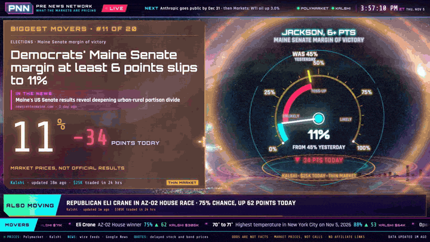
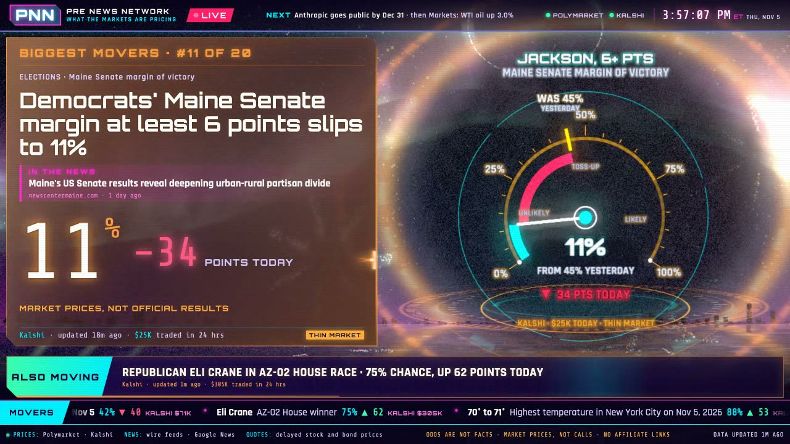
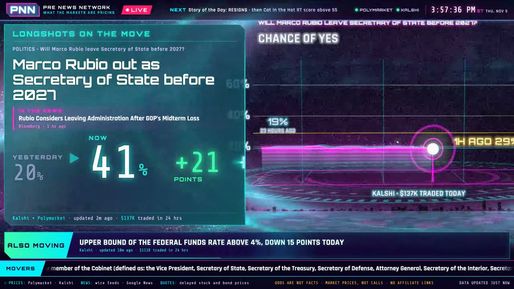
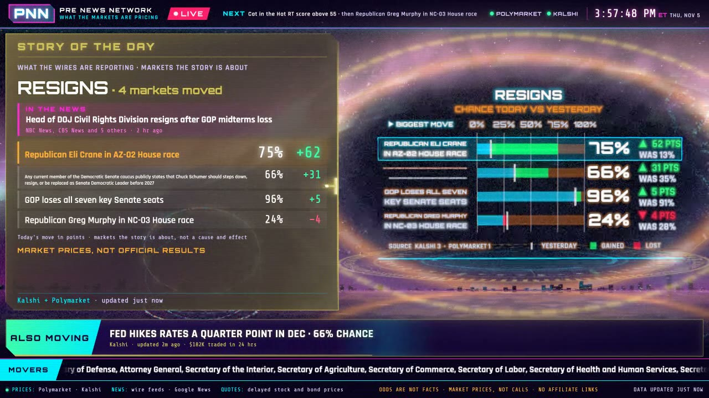
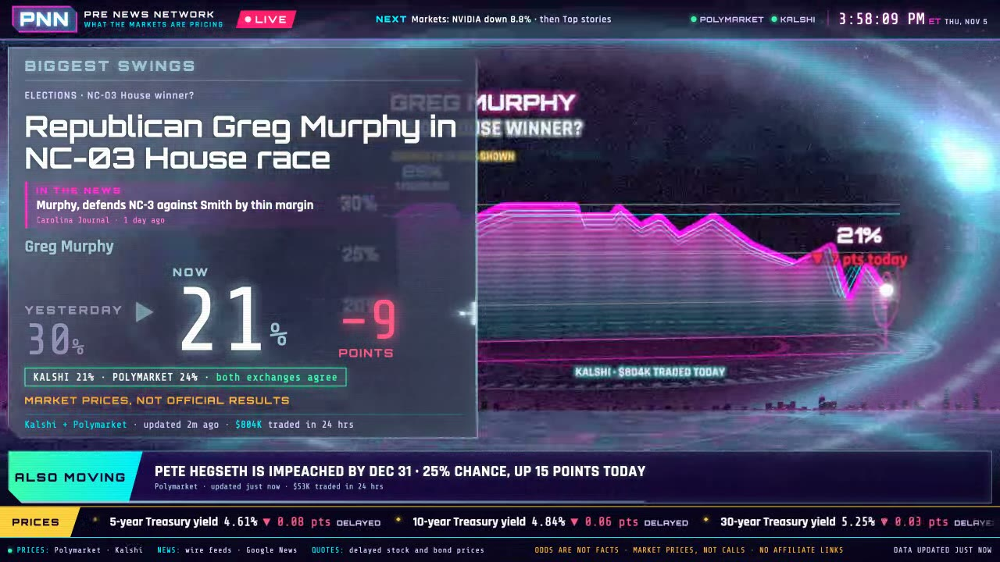

<div align="center">

# 📡 PNN: Pre News Network

**The news before it happens.** A 24-hour synthwave cable channel that reports what the prediction markets are pricing about current affairs, in plain English, paired with the headlines driving it.

[](LICENSE)
[](https://nodejs.org)
[](https://threejs.org)
[](package.json)
[](#quick-start)
[](https://claude.com/claude-code)



<sub>Live on Nov 5, 2026. Every number on screen is a real market price at that moment.</sub>

</div>

---

## What it is

On election night 2026, the betting markets had Democrats at 98 to 99% to win both chambers hours before any network made a call. **PNN** asks what a news channel looks like if it covers *what the markets expect*, not only what already happened.

Leave it running full screen on a TV or an iPad, and it behaves like a cable news channel:

- **News drives the rundown.** About 85 news wires and a targeted Google News search are clustered and matched to markets. A market airs only when there's a matching headline, or under a clearly labeled **MARKETS MOVING FIRST** tag when money moves before the news does.
- **Odds in plain English.** *"Marco Rubio out as Secretary of State before 2027: 41%, up 21 points."* Prices become percentages, moves become points, and nothing reads as a call. Every card shows the exchange, when it updated and how much traded.
- **Full-screen story cards** with a 3D hologram that fits the story: a dial for a single yes/no, a price replay with then-vs-now, an outcome race for multi-candidate markets, a globe for geopolitics and a countdown to the next big decision.
- **A real rotation.** Top stories, biggest movers, longshots on the move, this week's swings, category desks, Story of the Day, and a stocks-and-bonds desk that pairs big moves in Treasuries, oil, gold and mega-caps with the markets pricing what comes next.
- **Breaking alerts.** Big moves take over the screen, and corner pops flag fresh listings, money pouring in and markets that have gone quiet.
- **Twelve synthwave worlds.** Outrun highways, a laser cathedral, a megacity, a kaleidoscope tunnel, hyperspeed and more. The backdrop cuts in time with each story change (no crossfades) and is tinted by the story's desk.
- **Independent.** There are no affiliate links, referral codes or exchange sponsorships. War, violence and death markets are excluded, as are per-game sports bets, crypto price brackets and novelty markets.

<table>
<tr>
<td></td>
<td></td>
</tr>
<tr>
<td></td>
<td></td>
</tr>
</table>

## Quick start

You need Node 24 or newer. That's all: there are no dependencies to install, no build step and no API keys.

```bash
git clone https://github.com/pj4533/pnn.git
cd pnn
npm start            # live feeds → http://localhost:4180
```

Open **http://localhost:4180** full screen. It's designed for 16:9 landscape and also runs on an iPad (Add to Home Screen gives a full-screen app; tap the PNN logo to reload).

No network, or just want to look around?

```bash
npm run sim                                  # replays saved API samples, no network
open "http://localhost:4180/?fixture=1"      # static fixture with a fake wire, an alert at 5s
```

**Keys:** <kbd>Space</kbd> pauses, <kbd>←</kbd>/<kbd>→</kbd> step, and <kbd>1</kbd>–<kbd>7</kbd> force a segment (top stories, focus, movers, this week, desk, Story of the Day, countdown).

## How it works

```
 Polymarket ─┐                          ┌─ news wires (≈85 RSS) + Google News search
 Kalshi ─────┼─ pollers ─▶ one Market ─▶ editorial ─▶ Story ─▶ SSE ─▶ browser
 Yahoo, ─────┘   (polite,     shape      filter, rank,           (2D cards over a
 Treasury.gov     backoff)               news match, copy         Three.js scene)
```

- **One server polls; browsers never call the exchanges.** Polymarket (Gamma and CLOB history) and Kalshi are swept slowly in full, with a faster poll of the "hot" set, backing off on errors and 429s.
- **Everything normalizes into one Market shape**, so the UI doesn't care which exchange a price came from. When both list the same question, the card says whether they agree.
- **The editorial layer** (`server/editorial/`) filters noise and sensitive topics, ranks by what's moving, matches each market to news with question-aware rules, and writes the copy from templates (no LLM in the loop).
- **The browser** (`public/`) is plain ES modules and vendored Three.js. A director runs weighted shuffle bags so the same kind of card never airs twice in a row, and the scene, holograms and labels go through a bloom and grade post chain tuned for Safari and the iPad.

Details live in [`docs/ARCHITECTURE.md`](docs/ARCHITECTURE.md) (module contract, data shapes, ops) and [`docs/DECISIONS.md`](docs/DECISIONS.md) (every editorial and design call, with the reasoning).

## Editorial rules

These are enforced in code, not just written down:

1. **Odds are not facts.** Every line reads as a probability ("41%", "odds", "chance"). Never "X will…".
2. **Always show the source, time and size.** Thin markets are flagged.
3. **Never present a market as a call.** "Market prices, not official results" is on every card.
4. **Plain English.** No ¢, YES/NO tokens or basis points on screen.
5. **News drives the markets.** No headline, no airtime, apart from the labeled moving-first slot.
6. **Stay independent.** No affiliate links or sponsored embeds, and exchange-owned outlets don't count as news.

## Development

```bash
npm run check                         # node --check over every server and client file
node scripts/test-editorial.mjs       # editorial rules and copy
node scripts/test-sources.mjs         # exchange parsers against saved samples
node scripts/test-match.mjs           # news-to-market matcher
npm run health                        # feed status, counts, dead-content drops
npm run watch                         # live-ops log watcher
```

`PORT=4181 npm start` runs a second copy. Logs go to `logs/pnn.log`. The [`research/`](research/) folder has the prediction-market news landscape, verified API notes and real response samples for building parsers offline.

## Built with Claude Code

PNN was built in about two days, almost entirely by [Claude Code](https://claude.com/claude-code) running multi-agent workflows: planners, builders and reviewers in parallel worktrees, verifying on screen in WebKit and Chrome and against real-device frame telemetry from an iPad. [`CLAUDE.md`](CLAUDE.md) holds the rules the agents work under, so a new session can pick up where the last one left off.

It spun out of [Election Night](https://github.com/pj4533/election_night), a 3D election-results broadcast built live on Nov 3, 2026.

## Disclaimer

PNN shows market prices, which are not predictions of record, official results or financial advice. It isn't affiliated with Polymarket, Kalshi or any exchange. Stock and bond quotes are delayed.

## License

[MIT](LICENSE). Three.js and the world-atlas geometry in `public/vendor/` keep their own licenses.
