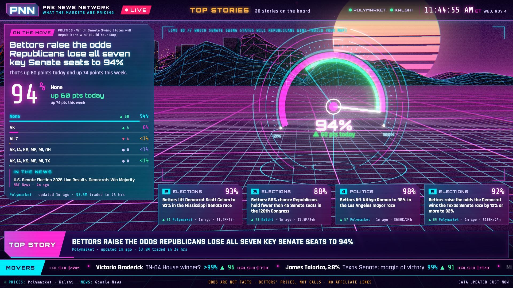
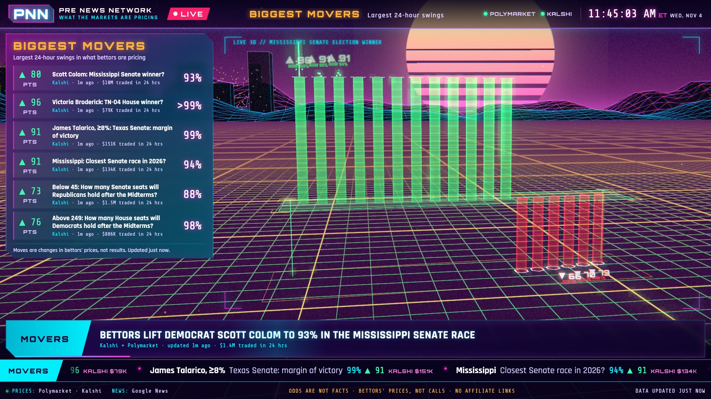
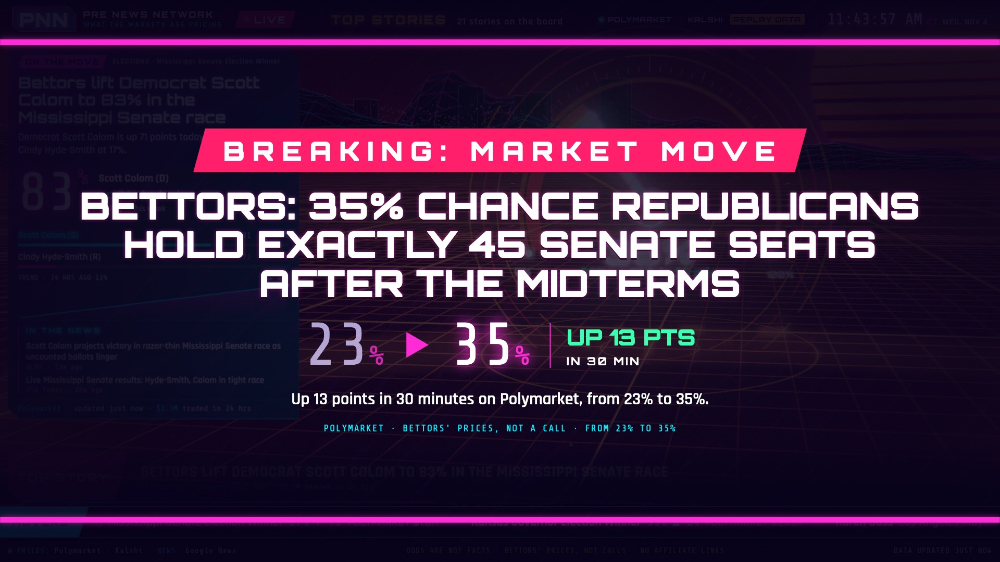

# PNN: Pre News Network

**The news before it happens:** a 24-hour broadcast-style channel that reports what prediction markets are pricing about current affairs, in plain English.

> *"Bettors now give the Fed an 80% chance of hiking in December, up 7 points today."*

On election night 2026, the betting markets had Democrats at 98–99% to win both chambers hours before any network called them. PNN asks what a news channel looks like if it covers **what the markets expect**, not only what already happened.

## What it does

- **Tracks** markets on politics, geopolitics, the economy, courts, tech and culture, across Kalshi and Polymarket (about 39k markets polled, roughly 1.4k Kalshi markets kept after filtering).
- **Reports the moves** as plain-English headlines, always attributed to bettors, with the source, the time and the 24h volume. Thin markets are flagged.
- **Pairs each story with news headlines** ("In the news"), without claiming they caused the move.
- **Broadcasts** like a cable channel: a rotating rundown (top stories, story focus, biggest movers, this week), full-screen breaking alerts on big swings, a ticker and a 3D Three.js scene behind 2D overlays.
- **Stays independent:** no exchange sponsorship or affiliate links. Sports, crypto, novelty and sensitive (war, death) markets are off.

## Quick start

Needs Node 24 or newer. No install step and no API keys.

```
npm start          # live feeds, then open http://localhost:4180
npm run sim        # replay saved samples, no network, alerts about every 2 min
npm run check      # syntax-check server/ and public/js/
npm run health     # curl /api/health (feed status, counts)
npm run watch      # live-ops watcher: warnings, alerts, health every 30s
```

- `http://localhost:4180/?fixture=1` loads a static fixture with no server data (add `&alerts=1` for a fake alert each minute, `&noscene=1` to skip 3D). Space pauses, arrows step.
- `PORT=4181 npm start` runs on another port.
- Logs go to `logs/pnn.log`. Tests: `node scripts/test-sources.mjs` and `node scripts/test-editorial.mjs`.

## Screenshots

Captured at 1920x1080 (the full set of test screenshots lives in `docs/shots/`, which is gitignored):





## Status

The MVP is built and runs end to end on live data.

- [`docs/ARCHITECTURE.md`](docs/ARCHITECTURE.md): module contract, shapes and runtime/ops.
- [`docs/DECISIONS.md`](docs/DECISIONS.md): decisions and calls made during the build.
- [`docs/HANDOFF.md`](docs/HANDOFF.md): origin and original plan.
- [`research/`](research/): who reports on market odds, API notes and a 2026-11-04 snapshot.

Known gaps: Kalshi markets outside the hot set refresh only with each 20-minute sweep; merged cross-exchange stories show only the lead market's volume; SIM has no Kalshi data; daily and weekly Kalshi series are off until they have a better baseline.

## Related

Built on lessons from [Election Night](https://github.com/pj4533/election_night), a live 3D election-results broadcast built with Claude Code on Nov 3, 2026.
